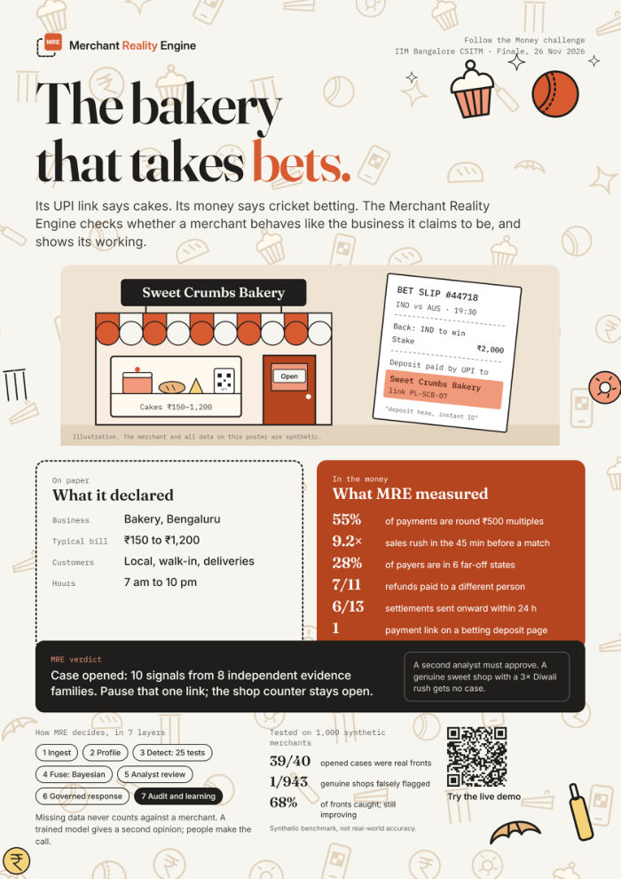
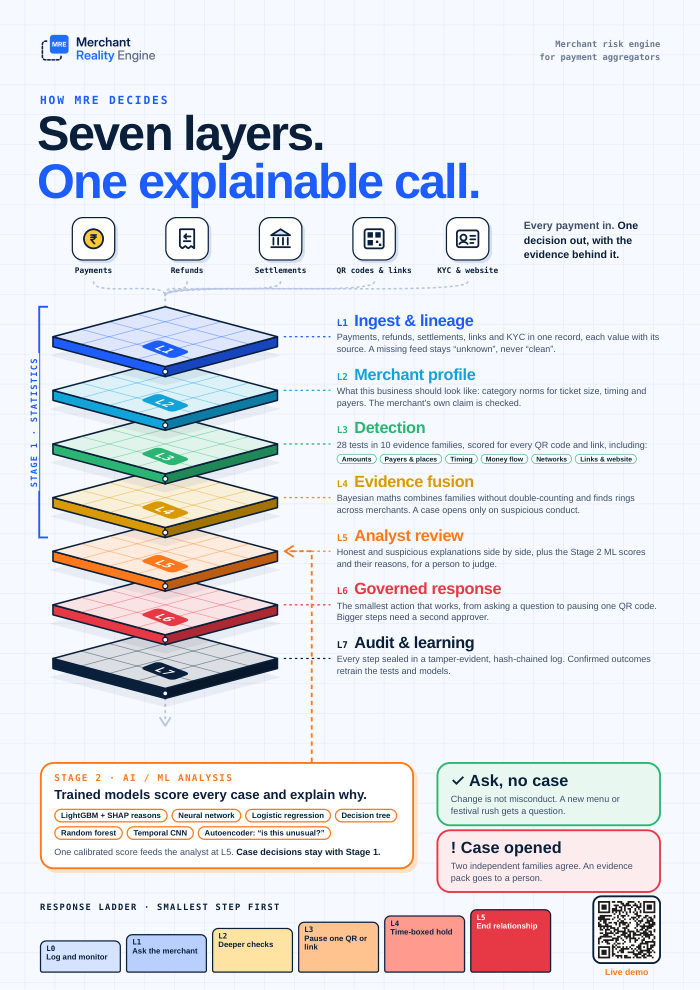
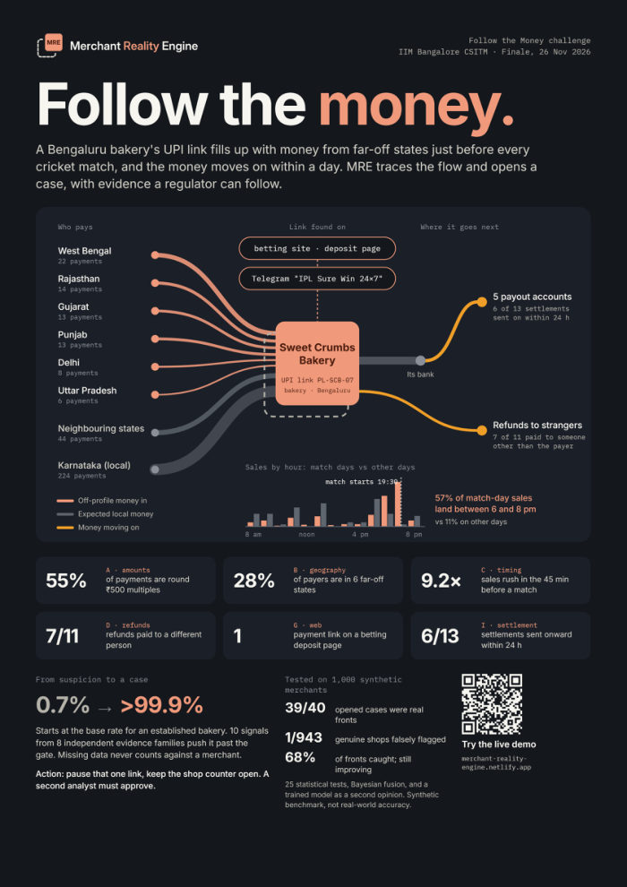
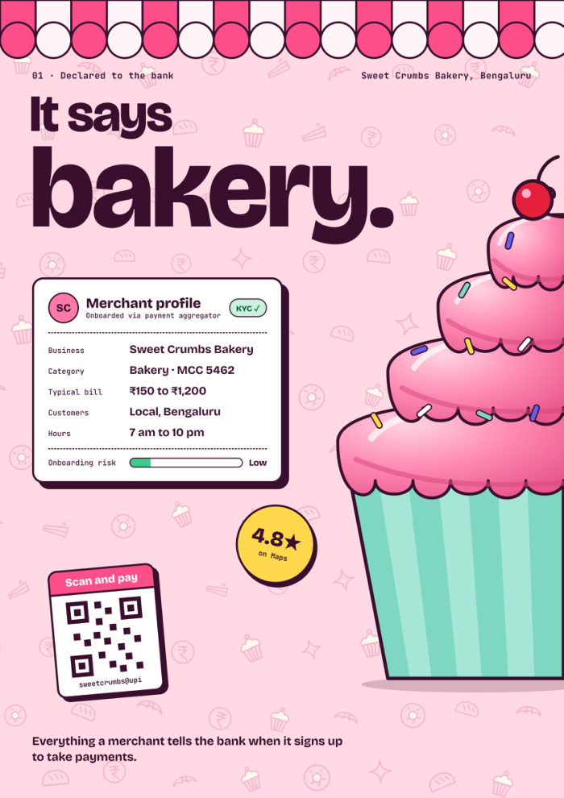
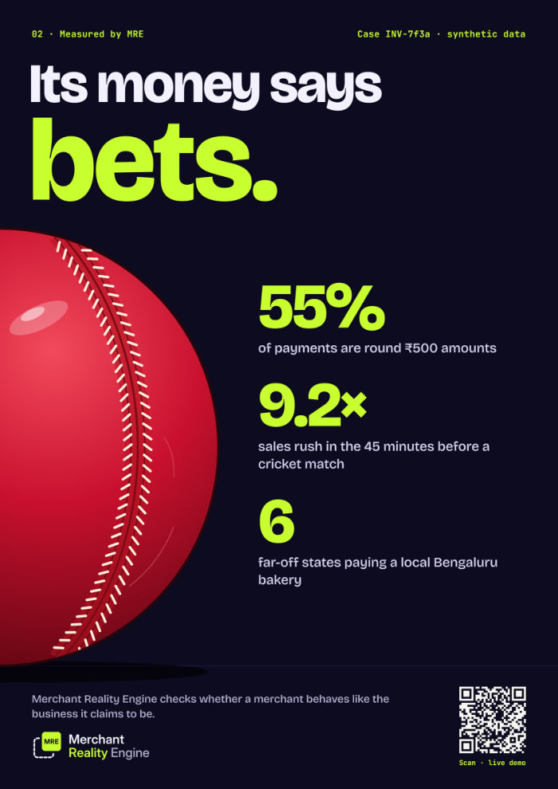
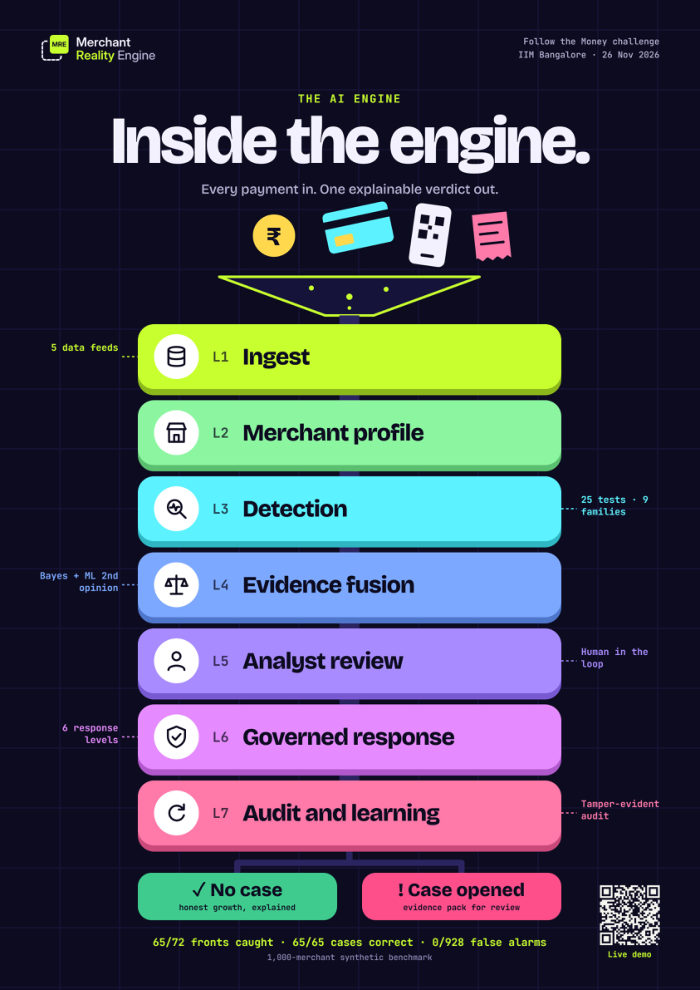
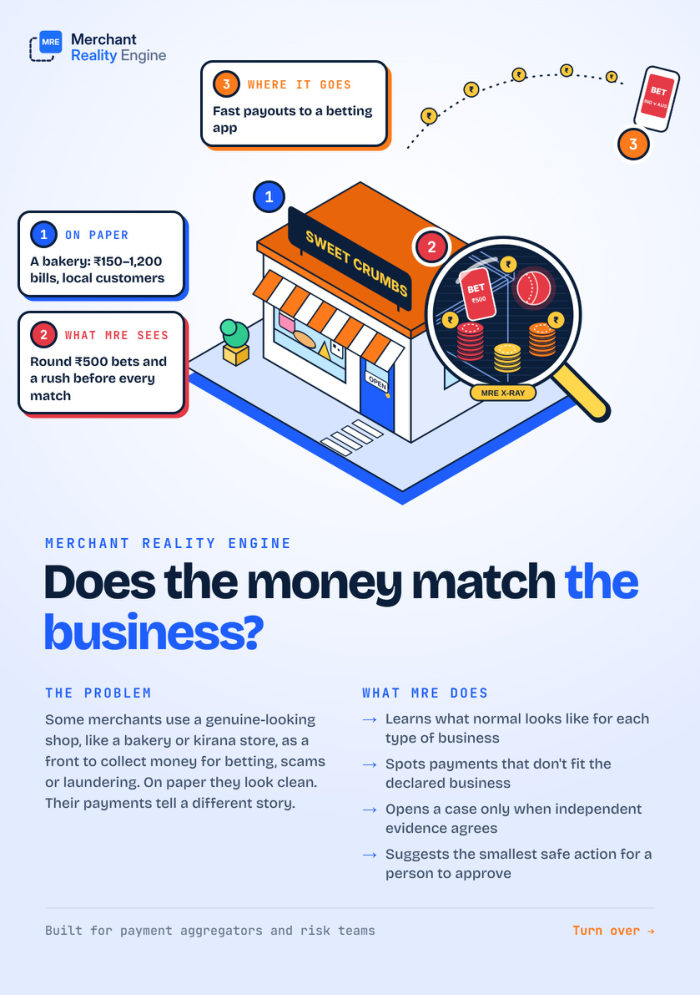
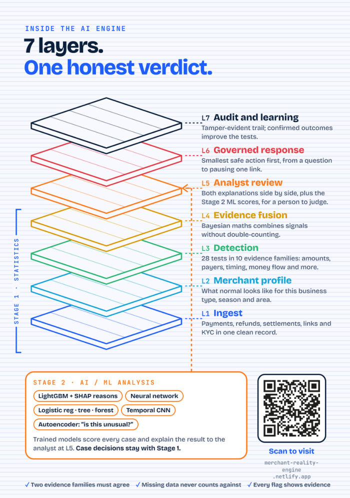
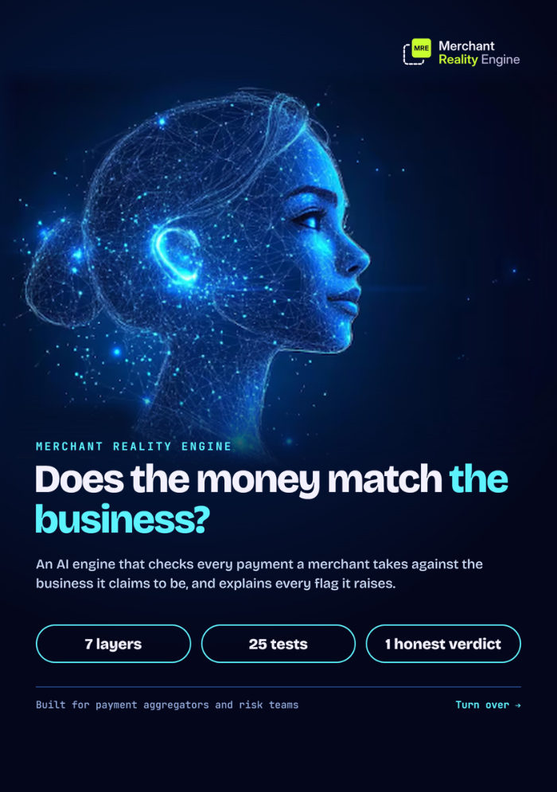
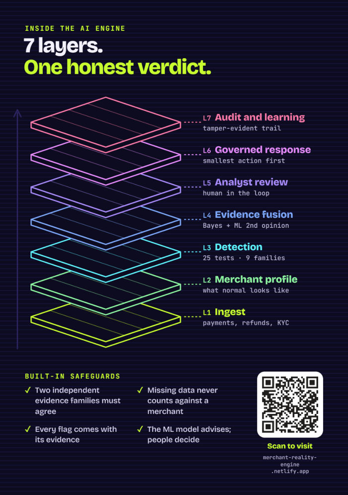

<div align="center">

<a href="https://ironman2102.github.io/Merchant-RealityEngine/">
  <picture>
    <source type="image/webp" srcset="media/mre-stall-loop.webp">
    
  </picture>
</a>

<picture>
  <source media="(prefers-color-scheme: dark)" srcset="frontend/public/logo-dark.svg">
  
</picture>

### See the business behind *every* payment.

**Does this merchant behave like the business it claims to be?**

[](https://merchant-reality-engine.netlify.app/)
[](https://ironman2102.github.io/Merchant-RealityEngine/)
[](media/MRE_Stall_Loop_1080p60.mp4)


<sub>Built for the <b>Follow the Money</b> challenge · IIM Bangalore · finale 26 November 2026</sub>

</div>

---

## The problem

<table>
<tr>
<td width="55%">

A shop is **registered and verified**. On paper it's *Sweet Crumbs Bakery*, MCC 5462, Bengaluru: ₹150–1,200 bills from local customers.

But every night before a match its QR code takes **round ₹500, ₹1,000 and ₹2,000 payments** from payers in other states, and the money leaves fast to a betting app. **Every single payment looks fine.** Only the *pattern* gives it away.

Payment aggregators onboard thousands of merchants like this. KYC checks the paperwork once. **MRE watches the money, all the time**, and asks whether it matches the business.

</td>
<td width="45%">

</td>
</tr>
</table>

## What MRE does

| | |
|---|---|
| 🧭 **Learns normal** | What a bakery, kirana store or salon *should* look like: ticket sizes, hours, payer geography, refunds and settlement speed for each MCC. |
| 🔍 **Spots misfits** | 28 statistical detectors in 10 evidence families, scored for **every QR code and payment link**, so side business can't hide inside shop averages. |
| ⚖️ **Opens cases only on evidence** | Bayesian fusion opens a case only when **two independent evidence families agree**. A new menu or a festival rush gets a question, not a freeze. |
| 🪜 **Suggests the smallest safe step** | From "ask the merchant" up to pausing one QR code. Bigger steps need a second human approver. |
| 🧾 **Shows its working** | Every flag carries its evidence, and every action is sealed in a tamper-evident, hash-chained audit log. |

## Seven layers, one explainable call

<table>
<tr>
<td width="42%">

</td>
<td width="58%">

| Layer | What happens |
|---|---|
| **L1 · Ingest & lineage** | Payments, refunds, settlements, links and KYC in one record. A missing feed stays *unknown*, never *clean*. |
| **L2 · Merchant profile** | Category norms for ticket size, timing and payers. The merchant's own claim is checked. |
| **L3 · Detection** | 28 tests across amounts, payers & places, timing, money flow, networks, links & website. |
| **L4 · Evidence fusion** | Bayesian maths combines families without double-counting and finds rings across merchants. |
| **L5 · Analyst review** | Honest and suspicious explanations side by side, plus Stage 2 ML scores and their reasons. |
| **L6 · Governed response** | The smallest action that works. Bigger steps need a second approver. |
| **L7 · Audit & learning** | Hash-chained log. Confirmed outcomes retrain the tests and models. |

**Stage 2 · AI/ML second opinion:** LightGBM + SHAP, a neural network, logistic regression, decision tree, random forest, a temporal CNN and an autoencoder ("is this unusual?"). One calibrated score goes to the analyst at L5. **Case decisions stay with Stage 1.**

</td>
</tr>
</table>

**Response ladder, smallest step first:** `L0 Log & monitor` → `L1 Ask the merchant` → `L2 Deeper checks` → `L3 Pause one QR or link` → `L4 Time-boxed hold` → `L5 End relationship`

## The workspace

- **Public story** (`/`, `/architecture`): a scroll-driven 3D bakery story, the seven-layer architecture and the governance model.
- **Guided demo** (`/demo/*`): prebuilt deterministic merchant scenarios, per-QR stream scoring and Context Passport walkthroughs across L1–L7.
- **AI Engine & Ops Console** (`/ai-engine/*`): bulk and single CSV/JSON upload, cross-merchant N4/N5 ring detection, server-side SQLite persistence, two-person Context Passports, a maker/checker response and label workflow, calibration governance and Stage 2 ML ensemble comparison.

> [!IMPORTANT]
> **Everything is synthetic.** Merchants, transactions, websites, crawler snapshots and benchmark figures are fabricated and deterministic. Nothing here is verified real-world accuracy, and nothing executes live payment holds or regulatory filings.

## Posters & pamphlets

Print material from the finale stall. Click any poster to open the full-resolution PDF.

<table>
<tr>
<td align="center" width="25%"><a href="docs/posters/poster1-the-storefront-A3.pdf"></a><br><sub><b>The storefront</b> · A3</sub></td>
<td align="center" width="25%"><a href="docs/posters/poster2-money-flow-map-A3.pdf"></a><br><sub><b>Follow the money</b> · A3</sub></td>
<td align="center" width="25%"><a href="docs/posters/option6-left-it-says-bakery-A3.pdf"></a><br><sub><b>It says bakery</b> · A3</sub></td>
<td align="center" width="25%"><a href="docs/posters/option6-right-its-money-says-bets-A3.pdf"></a><br><sub><b>Its money says bets</b> · A3</sub></td>
</tr>
<tr>
<td align="center"><a href="docs/posters/engine-poster-v2-A3.pdf"></a><br><sub><b>How MRE decides</b> (v2) · A3</sub></td>
<td align="center"><a href="docs/posters/engine-poster-how-mre-decides-A3.pdf"></a><br><sub><b>How MRE decides</b> (v1) · A3</sub></td>
<td align="center"><a href="docs/posters/mre-stall-posters.pdf"></a><br><sub><b>Stall poster</b> · page 1</sub></td>
<td align="center"><a href="docs/posters/mre-stall-posters.pdf"></a><br><sub><b>Stall poster</b> · page 2</sub></td>
</tr>
<tr>
<td align="center"><a href="docs/posters/pamphlet-stall-A5.pdf"></a><br><sub><b>Stall pamphlet</b> · front</sub></td>
<td align="center"><a href="docs/posters/pamphlet-stall-A5.pdf"></a><br><sub><b>Stall pamphlet</b> · back</sub></td>
<td align="center"><a href="docs/posters/pamphlet-front-v2-A5.pdf"></a><br><sub><b>Pamphlet front</b> (earlier) · A5</sub></td>
<td align="center"><a href="docs/posters/pamphlet-back-A5.pdf"></a><br><sub><b>Pamphlet back</b> (earlier) · A5</sub></td>
</tr>
</table>

🎬 **Stall film:** a 24-second seamless loop at [1080p60](media/MRE_Stall_Loop_1080p60.mp4). Watch it full screen, playing on repeat, on the [showcase page](https://ironman2102.github.io/Merchant-RealityEngine/).

## Measured on synthetic suites

All figures below were measured locally against synthetic generators (`engine/synthetic.ts` and `tests/datasets-1k/`). They are regression and direction benchmarks, not real-world accuracy.

| Metric | Measured | Source / Command |
|---|---|---|
| Synthetic benchmark (`n = 1,000`, `seed = 7`) | Recall `33/81` (`0.407`), Opened/Asked `67/81` (`0.827`), Precision `33/33` (`1.000`), Honest FP `0/919` (`0.000`) | `npm run benchmark` |
| 1,200-case stress benchmark (`rules=mre-bayes-0.3.0`) | TP `457`, FP `0`, TN `600`, Recall `0.7617`, Precision `1.0000`, FPR `0.0000`, `0` integrity errors | `npx tsx scripts/benchmark-1k.ts` -> `reports/benchmark-1k.md` |
| One-shot multi-dataset verification (`100` datasets) | `57/60` multi-source fronts opened (single-source fronts routed to `ASK`), `0/40` genuine FPs | `npm run test:stats` (`one-shot-portfolio`) |
| Stage 2 M1 vs Bayesian on leak-free `engine/synthetic.ts` | M1 AUC-PR `0.997` (`ECE 0.017`, `129/131` at `0.10`, FP `7/256`); Bayesian AUC-PR `0.936` (`0/256` FP). Stage 2 v1 stacked ensemble (served): AP `0.999`, Brier `0.011`, ECE `0.017` on 387 held-out merchants (`reports/stage2-v1-evaluation.json`). On the 11 demo samples, never used for training, v1 flags all 6 fronts and none of the 5 honest merchants | `.venv/bin/python -m ml.compare` |

ML models (`m1-v0`, `nn-v0`, `classical-v0`) are second opinions only. They never open cases or override the independent Bayesian conduct gate.

## Run it

Requires **Node.js `>=22.13`** and, for Stage 2 ML, Python 3 with the packages in `ml/requirements.txt`.

```bash
npm install
npm run dev        # Vite frontend          → http://localhost:5173
npm run api        # API + analyst console  → http://127.0.0.1:8787
npm run build      # Bundle Netlify/API adapter + tsc --noEmit + frontend & console builds
npm test           # Engine stats, selftest, API check, dataset import, 35 security probes, 34 adversarial cases, lint
```

Optional benchmark and ML commands:

```bash
npm run benchmark                                # 1,000-merchant leak-free synthetic benchmark
npm run redteam                                  # 8 evasion operators across 98 caught fronts
.venv/bin/pytest ml/tests/                       # 18 Python Stage 2 ML & FastAPI tests
npx tsx ml/generate_synthetic_features.ts        # Regenerate leak-free ml/data/features.csv (1,288 merchants)
```

> [!NOTE]
> **Upgrading an existing local SQLite DB:** databases created before table HMAC sealing need `npm run mre -- seal-db --reason "initial seal"` once, or use `MRE_CASE_STORE=memory` in test runs.

## Core capabilities

- **Conduct vs. change separation (`rules/engine.json` v0.3.0):** unusual hours, ticket shifts or volume changes without misconduct trigger `followUp: ASK` (no case, no restriction) rather than false-positive freezes.
- **Per-QR stream scoring & scoped actions:** scores every payment link/QR (`30+` sales) and repeat-payer sub-cohort individually, so side betting can't hide inside shop averages. Restriction recommendations are isolated to the suspect links.
- **Delivered-order excuse:** delivered online orders legitimately explain out-of-state payers, matched one sale per order against the fulfilment feed.
- **Two-person Context Passports:** merchants can document legitimate operational changes per QR for up to 180 days, with a human maker and a distinct reviewer. Any conduct signal suspends passport relief, and revocation reopens affected cases.
- **Multi-dataset upload & ring detection (`N4`/`N5`):** batch CSV/JSON ingestion with shared settlement beneficiary (`N4`) and shared payer-cohort (`N5`) detection, calibration drift (`PSI`), empirical peer baselines and uncertainty sets (Stage 2 ML adds split-conformal sets).
- **Stage 2 ML ensemble & explainability:** calibrated LightGBM (`TreeSHAP`), MLP, logistic regression, decision tree and random forest, trained strictly on `BEHAVIORAL_FEATURE_COLUMNS`, with no age, prior or coverage leakage (verified by `tests/engine/leakage.test.ts`).
- **Multi-rail payments:** UPI, card, net banking and wallet payments go through the same evidence model.
- **Hardened auth, service keys & tamper-evident audit:** strong `scrypt` passwords, OIDC PKCE, `/v1` client-isolated service keys, HMAC-sealed tables, hash-chained audit logs, and two-person approval for label changes, downgrades, lifts and rule promotions/rollbacks.

## Documentation

| Doc | What's inside |
|---|---|
| [Architecture](docs/ARCHITECTURE.md) | System design across the seven layers |
| [Business case](docs/BUSINESS_CASE.md) · [Pitch](docs/PITCH.md) | Why payment aggregators need this |
| [Demo guide](docs/DEMO_GUIDE.md) | Walking through the guided demo |
| [Patterns](docs/PATTERNS.md) · [Claims](docs/CLAIMS.md) | The fraud patterns and what we claim (and don't) |
| [Stage 2 ML](docs/STAGE2_ML.md) | Models, features, calibration and evaluation |
| [Data model](docs/DATA_MODEL.md) · [Dataset format](docs/DATASET_FORMAT.md) | Bringing your own data |
| [Mathematical reference (PDF)](docs/MRE_Mathematical_Reference.pdf) | The maths behind every detector and the fusion |
| [Judge Q&A](docs/JUDGE_QA.md) | Hard questions, straight answers |

## Project layout

```text
package.json, tsconfig.json, vite.config.ts, start.sh
frontend/src/    React 18 + Vite + Tailwind CSS v4 app (components, data, engines, layers, pages, stats, utils)
engine/          Shared pure modules (features, portfolio FDR, ringDetector, driftMonitor, peerBaselines, synthetic, pack, outreach, improver)
rules/           Versioned declarative priors, 28 detectors, ~40 MCC norms, overrides, hosts, workflow rules
adapters/        PA CSV/JSON mappers, pseudonymisation, privacy scrubbing
backend/         HTTP API, SQLite + memory store, auth, OIDC, service keys, passports, workflow, HMAC integrity seals
cli/             `mre` CLI (analyze, batch, verify-db, seal-db, features)
ml/              Python LightGBM (`m1-v0`), MLP (`nn-v0`), classical ensemble, FastAPI scorer (`serve.py`), pytest suite
tests/engine/    20+ deterministic engine, security, leakage, regression, and 100-dataset end-to-end suites
api/             Vercel / Netlify serverless entry point (`netlify/functions/api.mts`)
docs/posters/    Print posters and pamphlets (PDF) with previews
media/           The stall film (MP4) and the looping banner
```

## Team

Built by **Sriyanth**, **Dhruv Bhandari**, **Chinmay S**, **Chetana R** and **Devarshee Jitendra Mude**.

<div align="center">
<br>
<br>
<sub>Merchant Reality Engine · all data synthetic</sub>
</div>
